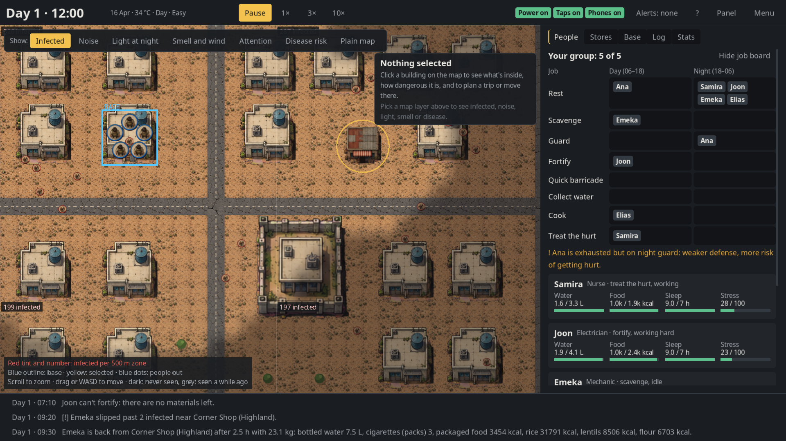
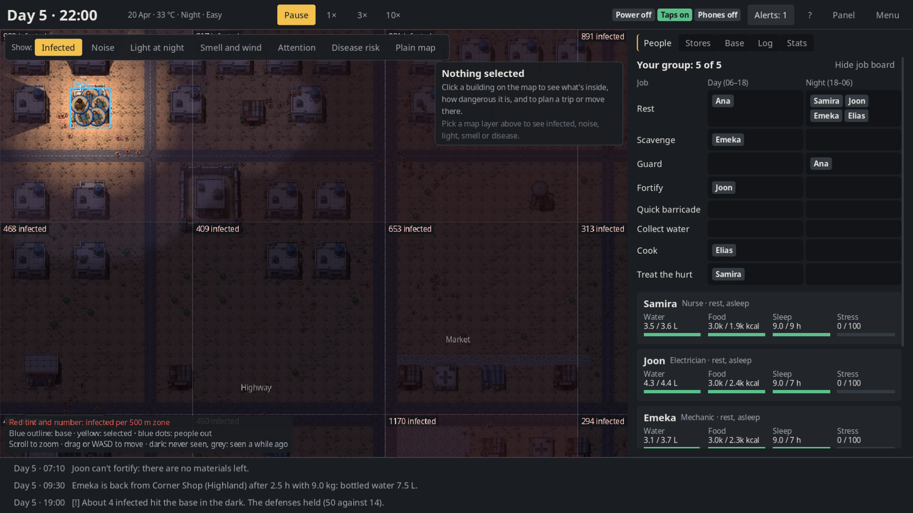
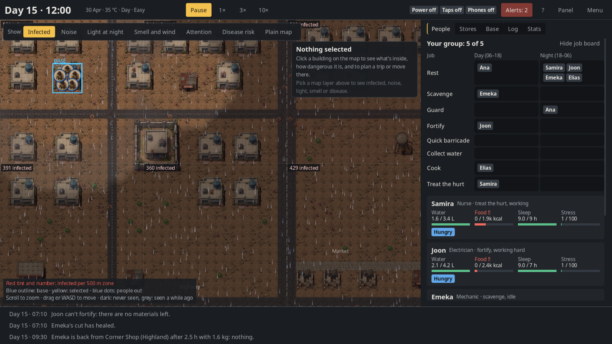
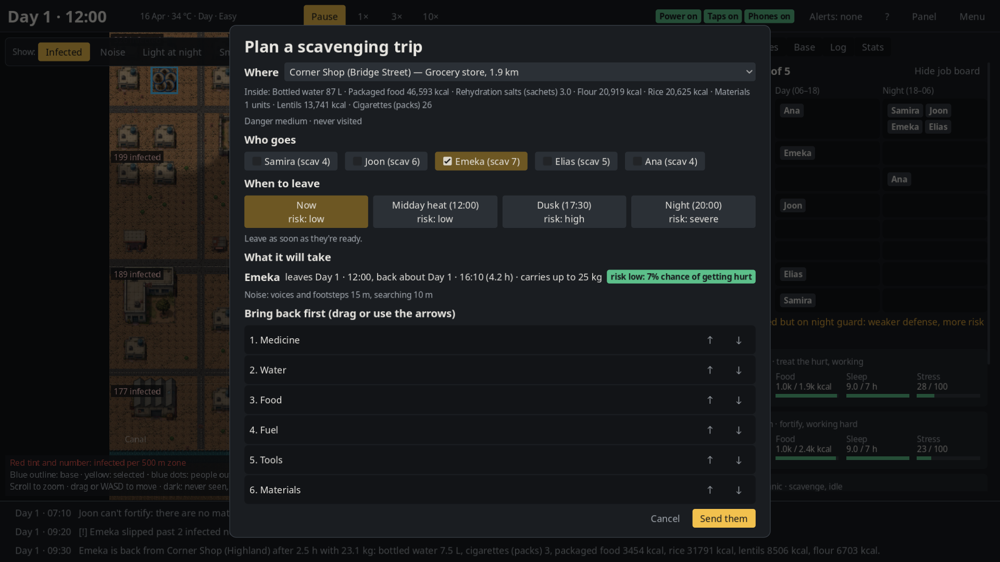
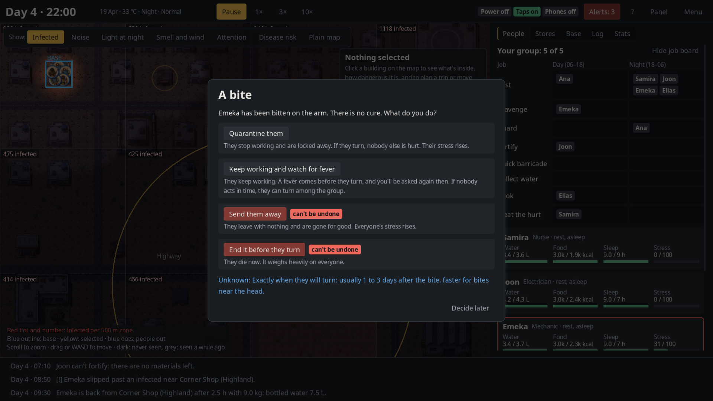

# SZA: a realistic zombie survival strategy sim

Lead five survivors through the first thirty days of an outbreak in a small town. You don't steer anyone around: you give orders and make the hard calls, and the world keeps running whether you're watching or not.

The infected are **sick living people**, not the undead. They tire in the midday heat, hunt at night, are drawn by noise and light, and slowly die off. Water is counted in litres, food in kilocalories, blood loss in millilitres. Nothing is a magic health bar.



## What you do

- **Assign jobs** by day and by night: scavenge, guard, fortify, collect water, cook, treat the hurt, rest.
- **Plan scavenging trips:** who goes, when they leave (midday is safest, night is deadly) and what they bring back first. The planner shows the return time, how much they can carry and the chance of getting hurt, worked out with the game's own rules.
- **Keep the base alive** after the power fails (day 3–6) and the taps run dry (day 7–12). Ration food and water, boil what you collect, decide whether the generator's light is worth the attention it draws.
- **Make the hard calls.** Someone is bitten: quarantine, watch, send away, or end it. A stranger at the gate. Antibiotics for a wound now, or kept for something worse.
- **Stay hidden or keep moving.** A base that stays put builds up attention (voices, smoke, hammering, light) and draws night attacks. Moving costs supplies, barricades and nerves.

Every number explains itself: hover it to see what it's made of and where it's heading.

| | |
| --- | --- |
|  |  |
| **Night.** Light from the base spills down the lanes and shows why it draws the infected. | **Weather.** Rain fills the tanks and wets the roads. Midday heat shimmers. |
|  |  |
| **Trip planner.** Who goes, when, what to bring back, and the real risk. | **Decisions.** What each choice does, what nobody can know yet, and what can't be undone. |

## Features

- **A living town:** about 50 buildings with finite loot that other (unseen) survivors strip day by day; 16 zones of infected that grow, wander towards noise and die off.
- **Bodies and minds:** thirst, hunger, sleep, body heat, bleeding, wound infection to sepsis, waterborne illness, and stress that makes people refuse work or leave.
- **Twelve survivors** with real jobs and traits (smoker, light sleeper, strong back, squeamish…). Names, and the town's name, are new every run.
- **Twelve events with causes:** lockdown, panic buying, a relief camp that falls, a market fire, heat waves, storms, a stranger at the gate.
- **Three difficulties:** the same realistic rules, a bigger and harsher world.
- **Graphics and sound:**
  - sprite-drawn town with day/night lighting, rain, heat shimmer, smoke, and weeds that creep over the roads
  - a fog of what your group has seen
  - ambience and sound effects
  - Low/Medium/High quality, and Reduce motion
- **Saves:** autosave every dawn and quick save/load. Runs are seeded: the same seed and choices replay exactly.

## Play it

You need [Godot 4.3 or later](https://godotengine.org/download) (tested on 4.7.2). From this folder:

```
godot --headless --import      # once, on a fresh clone
godot                          # start screen: difficulty, survivors, seed
godot -- --difficulty=easy --seed=42   # straight into a run
```

**Controls:**

| Input | Action |
| --- | --- |
| Space | pause / resume |
| 1 / 2 / 3 | speed: 1× (a day in 72 s), 3×, 10× |
| Mouse wheel / drag / WASD | zoom and move the map |
| Click a building | see what's inside; plan a trip or move there |
| Tab | hide the side panel |
| Esc | menu: save, load, settings, new run |
| Ctrl+S / Ctrl+L | quick save / load |
| ? | every key |

**New to it?** Start on Easy. Grab the pharmacy before it's raided, fill every container before the taps fail, and send scavengers out at midday.

## For developers

| What | Command |
| --- | --- |
| All tests (175 checks) | `bash tools/run_tests.sh` |
| One run with no UI, told as a story | `godot --headless --script res://tools/headless_runner.gd -- --difficulty=normal --seed=7 --days=30 --strategy=balanced --verbose=1` |
| Balance batch (auto-player) | `godot --headless --script res://tools/headless_runner.gd -- --games=40 --difficulty=all --strategy=all` |
| Frames per second for each graphics preset | `godot res://tools/fps_bench.tscn -- --size=1920x1080` |
| Screenshot | `godot res://tools/screenshot.tscn -- --difficulty=normal --seed=3 --hours=48 --zoom=2 --out=/tmp/shot.png` |
| Re-cut the sprite sheet / regenerate sounds | `python3 tools/slice_sheet.py assets/source/sheet_v1.png assets/sprites` / `python3 tools/make_sounds.py` |

```
data/      all content as JSON: items, buildings, loot, survivors, traits, events, names, town layout, difficulty
core/      autoloads (Rng, EventBus, WorldState, Data, TickLoop) and shared helpers
systems/   the simulation, one system per file; systems talk only through WorldState and the EventBus
render/    the drawn town, lighting, weather, fog and audio (readers only)
ui/        the screen: HUD, panels, planner, decision windows, charts
tools/     headless runner, auto-player, screenshot and benchmark tools, asset scripts
tests/     headless test suites
```

The simulation never touches the screen, so it runs headless for tests and balance batches, and an automated player measures every balance change. More detail:
- **[docs/GAME_GUIDE.md](docs/GAME_GUIDE.md):** every rule and number.
- **[docs/GAME_DESIGN.md](docs/GAME_DESIGN.md):** the design.
- **[docs/IMPLEMENTATION_NOTES.md](docs/IMPLEMENTATION_NOTES.md):** decisions and balance results.

## Credits

See [CREDITS.md](CREDITS.md). The sprite sheet was generated with ChatGPT (OpenAI). The sounds are synthesised by `tools/make_sounds.py`. Everything else is procedural.
